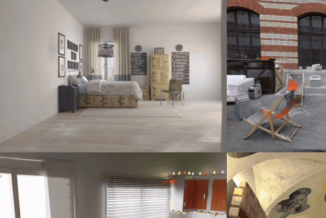
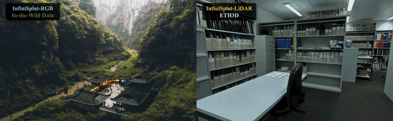

# InfiniSplat

Feed-forward 3D Gaussian reconstruction from images.

| Version | Input | Getting started |
| --- | --- | --- |
| **[InfiniSplat v2](v2/README.md)** | Multiple overlapping images, optionally with calibrated cameras | [Installation](v2/INSTALL.md) · [Examples](v2/examples/README.md) · [COLMAP](v2/docs/colmap.md) |
| **[InfiniSplat v1](v1/README.md)** | A single RGB image, optionally with LiDAR depth | [Installation](v1/INSTALL.md) · [Inference](v1/docs/inference.md) |

## InfiniSplat v2

<div align="center">

<h2>InfiniSplat v2: Analyzing and Improving Feed-Forward 3DGS from Any Views</h2>

<p>
  <a href="https://github.com/Edisoneh">Yongzhen Hu<sup>1,2*</sup></a> ·
  <a href="https://ritianyu.github.io/">Hao Yu<sup>1*</sup></a> ·
  <a href="https://plus-wave.github.io/">Jiawei Wang<sup>1</sup></a> ·
  Xianming Zeng<sup>2</sup> · Jianyun Xu<sup>2</sup> · Xingliang Liu<sup>2</sup> ·
  <a href="https://csse.szu.edu.cn/staff/ruizhenhu/">Ruizhen Hu<sup>3</sup></a> ·
  <a href="https://xzhou.me/">Xiaowei Zhou<sup>1</sup></a> ·
  <a href="https://person.zju.edu.cn/en/0093140">Hujun Bao<sup>1</sup></a> ·
  <a href="https://pengsida.net/">Sida Peng<sup>1†</sup></a>
</p>

<p><sup>1</sup> Zhejiang University · <sup>2</sup> Hello TransTech · <sup>3</sup> Shenzhen University</p>
<p><sup>*</sup> Equal contribution. <sup>†</sup> Corresponding author.</p>

</div>

InfiniSplat v2 reconstructs 3D Gaussian scenes from multiple images, with or without
camera poses, for novel-view rendering.

<p align="center">
  <a href="https://zju3dv.github.io/InfiniSplat2/">
    
  </a>
  
  <a href="https://huggingface.co/spaces/Edisoneh/InfiniSplat-v2-demo">
    
  </a>
  <a href="https://huggingface.co/Edisoneh/InfiniSplat-v2">
    
  </a>
  <a href="v2/README.md">
    
  </a>
</p>

<div align="center">

<a href="https://zju3dv.github.io/InfiniSplat2/#demo"></a>

</div>

<!-- Replace the paper badge with its public paper link when available; update the project-page URL if its hosting location changes. -->

For installation, weight setup, camera modes, and runnable examples, see the
[v2 README](v2/README.md). Original-resolution [example inputs](https://huggingface.co/Edisoneh/InfiniSplat-v2/resolve/main/examples-png.zip) are hosted with the weights (90.4 MB).

---

## InfiniSplat v1

<div align="center">

<h2>🌌 InfiniSplat: Implicit Gaussian Decoding for Large-Baseline Monocular View Synthesis</h2>

<p align="center"><strong>SIGGRAPH Asia 2026 (ACM Transactions on Graphics)</strong></p>

<div align="center">
  <a href="https://zju3dv.github.io/InfiniSplat">
    
  </a>
  <a href="https://arxiv.org/abs/2608.02437">
    
  </a>
  <a href="https://zju3dv.github.io/InfiniSplat/#visualization">
    
  </a>
  <a href="https://huggingface.co/spaces/PLUS-WAVE/InfiniSplat">
    
  </a>
</div>

<p align="center">
  <a href="https://plus-wave.github.io/">Jiawei Wang<sup>*</sup></a> •
  <a href="https://ritianyu.github.io/">Hao Yu<sup>*</sup></a> •
  <a href="https://github.com/Edisoneh">Yongzhen Hu</a> •
  <a href="https://github.com/shmily768">Xinyi Yang</a> •
  <a href="#">Tao Ni</a> •
  <a href="#">Xin Zhan</a> •
  <a href="#">Junbo Chen<sup>†</sup></a> <br>
  <a href="https://xzhou.me/">Xiaowei Zhou</a> •
  <a href="https://csse.szu.edu.cn/staff/ruizhenhu/">Ruizhen Hu</a> •
  <a href="https://pengsida.net/">Sida Peng<sup>†</sup></a>
</p>

<p align="center"><sup>*</sup> Equal contribution. <sup>†</sup> Corresponding authors.</p>

</div>

<div align="center">



</div>

V1 supports single-image RGB reconstruction and depth-sensor-guided
reconstruction. Its installation guide, examples, and inference commands are in
[v1/](v1/README.md).

[Code and usage](v1/README.md) · [Installation](v1/INSTALL.md) ·
[Inference guide](v1/docs/inference.md)

---

## Repository layout

```text
InfiniSplat/
├── README.md
├── LICENSE
├── v1/
└── v2/
```

From the repository root, run `cd v1` for single-image reconstruction or `cd v2`
for multi-view reconstruction, then follow that version's installation guide.

Install each version in its own Python environment. V1 and v2 use different
dependencies and weights.

## License and Project Use

License: [Project Registration License (PRL) v1.0](LICENSE)

Use solely for academic research, education, evaluation, or personal purposes is free and does not require registration. Research results and publications may be published without registration.

Project use by companies, universities, or other organizations is free but requires prior registration, including non-commercial projects, internal R&D, testing, deployment, and production. Complete and accurate registration automatically grants permission; no approval or fee is required. Register each materially distinct project once.

**Project use registration and Word template:** [Google Forms](https://docs.google.com/forms/d/e/1FAIpQLSff5QjjANlJ2hnXYqBSAzKWxEM58gIxPLh17-t3j3-MqO1a5w/viewform)


V1 and v2 share the project license above. Third-party components retain their
respective licenses and notices; see [v2 component provenance](v2/THIRD_PARTY.md).

## Acknowledgments

See the [v1 acknowledgments](v1/README.md#-acknowledgments) and
[v2 acknowledgments](v2/README.md#acknowledgments).
